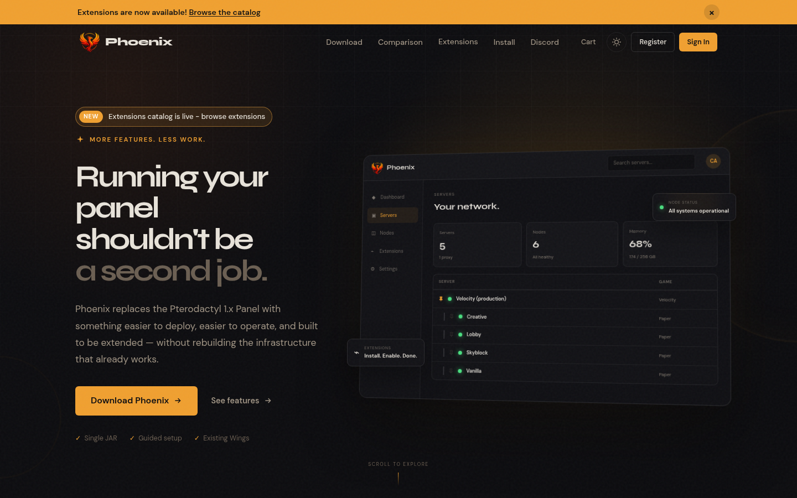
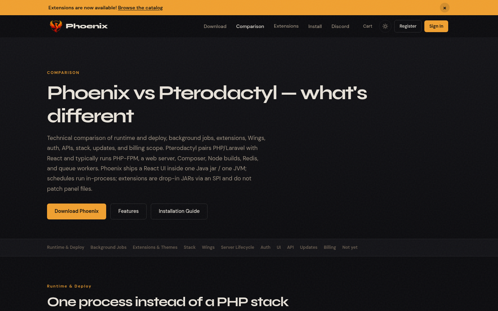
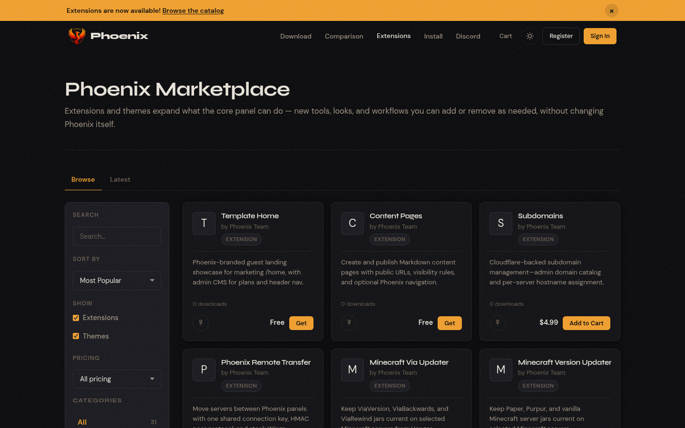

  

# Phoenix Panel Development

**Phoenix panel website: [phoenixpanel.io](https://phoenixpanel.io/)**

When I got early access to the [Phoenix panel](https://phoenixpanel.io/), it changed how I thought about what I could build. Most of what gets made for panels like this is gaming eggs and extensions, and there is nothing wrong with that. But working with Phoenix gave me the ambition to offer more than that: to build it out into a platform that small and medium-sized businesses can actually use day to day.

This repository is where that work lives.

## Screenshots

Screenshots of [phoenixpanel.io](https://phoenixpanel.io/), captured October 2026.

*The phoenixpanel.io homepage.*

*The Phoenix vs Pterodactyl comparison page.*

*The Phoenix Marketplace extensions and themes catalog.*

## Crafting Apps, the first egg

[Crafting Apps](eggs/crafting-apps/) is the first egg in that direction. It is one Phoenix/Wings egg that runs the Storytold creative apps: photocraft, vectorcraft, filmcraft, lightcraft, pdfcraft, effectcraft, and designcraft. You pick the app, and the egg installs it. In web mode the app runs right in the browser. In native mode you get a full desktop through noVNC. Either way, access stays private behind Tailscale. There is no public login page to worry about.

## Why I am building this

Small teams often need real creative and office tools, and the usual answer is another per-seat SaaS subscription. Many of these teams already host their own hardware, or already run a panel for something else. I want them to be able to put that hardware to work and run capable tools on it themselves, on their own terms, without paying per seat for every person who needs to open a file.

## Where it is headed

Crafting Apps is the start. I plan to keep adding business-ready eggs and extensions, shipped as Phoenix-compatible eggs, so a small business can set up the tools it needs from the same panel. Eggs live under [`eggs/`](eggs/crafting-apps/), and panel extensions will live under [`extensions/`](extensions/).

I am building this in the open, one piece at a time. If it is useful to you, I would be glad to hear about it.

— Mox Neo

## Public release eggs

Seven more eggs are published under [`eggs/`](eggs/):

- **Hermes Agent v3**: dashboard-first Hermes Agent on Debian 12 (amd64 and arm64); a random admin password is generated on first start and must be changed at first login. [`eggs/hermes-agent-v3/`](eggs/hermes-agent-v3/)
- **Invoice Ninja v5 (Octane)**: self-hosted invoicing and billing app on Octane/FrankenPHP, with all writable data kept in `/home/container`. Its image, `ghcr.io/moxneo/invoice-ninja:latest`, is not published yet. [`eggs/invoice-ninja/`](eggs/invoice-ninja/)
- **Listmonk**: self-hosted newsletter and mailing-list manager, using the official image and an external PostgreSQL database. [`eggs/listmonk/`](eggs/listmonk/)
- **Tailscale gateway**: runs the official Tailscale container as a userspace gateway node that joins your tailnet. [`eggs/tailscale-gateway/`](eggs/tailscale-gateway/)
- **Cloudflare tunnel**: outbound-only Cloudflare Tunnel connector (pinned, checksum-verified `cloudflared`) that publishes no ports. [`eggs/cloudflare-tunnel/`](eggs/cloudflare-tunnel/)
- **Odoo (External DB)**: Odoo 16/17/18 ERP and business apps against an external PostgreSQL server, with optional Git-based custom addons. [`eggs/odoo/`](eggs/odoo/)
- **ChromaDB**: persistent ChromaDB vector database server on the allocation port, with a local backup script. [`eggs/chromadb/`](eggs/chromadb/)

## Repository layout

- [`eggs/crafting-apps/`](eggs/crafting-apps/): Crafting Apps egg, image Dockerfile, install/start script, and technical documentation.
- [`extensions/`](extensions/): Phoenix panel extensions.
- `.github/workflows/crafting-apps-image.yml`: builds and publishes `ghcr.io/moxneo/crafting-apps`.
